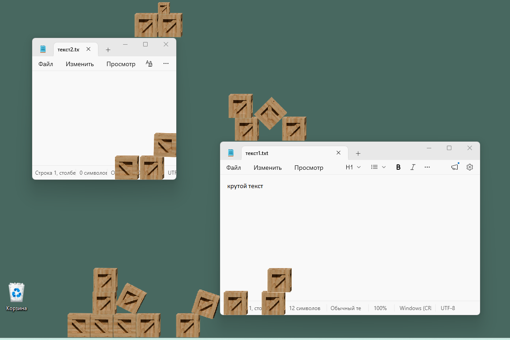
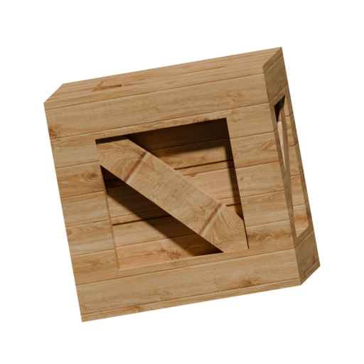
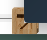

#  VirtualFriend (Виртуальный Друг)

**VirtualFriend** — это интерактивная утилита-игрушка для рабочего стола Windows, которая превращает ваши обычные окна проводника, браузера и других программ в осязаемые физические объекты, внутри которых кипит своя жизнь!

Главная фишка проекта — **«живая» симуляция коробками (а в будущем и персонажами)**, которые умеют падать на физический «пол» вашего экрана, биться о стены и запрыгивать внутрь открытых вами окон приложений.

---

## ✨ Что умеет программа?

*   **🪟 Окна как аквариумы:** Программа сканирует запущенные в Windows приложения. Каждое открытое окно получает невидимые физические границы. 
*   **📦 Физика коробок:** Вы можете спавнить интерактивные коробки, которые подчиняются законам гравитации. Они сталкиваются друг с другом, крутятся и падают.
*   **🌀 Телепортация сквозь пространства:** 
    *   Схватите коробку мышкой на рабочем столе и **забросьте её внутрь любого окна** (например, блокнота или браузера) — она останется жить внутри него!
    *   Передвиньте окно — коробки внутри него будут реалистично биться о его стенки.
    *   Сверните окно — программа поймет это и **вытолкнет** всех существ обратно на рабочий стол или в окно уровнем ниже.
*   ** Маскирование и глубина:** Объекты внутри окон не просто рисуются поверх — они обрезаются по краям приложения и прячутся, если одно окно Windows перекрывает другое.

---

## 🎮 Как управлять симуляцией?

После запуска программы на экране появится удобное графическое меню управления. Сама симуляция работает в фоне прямо поверх ваших окон.

| Действие | Управление |
| :--- | :--- |
| **Создать коробку** | Нажмите клавишу **`C`** (коробка появится точно под курсором мыши) |
| **Схватить и бросить** | Зажмите **ЛКМ** на объекте для перетаскивания. Резкое движение мыши придаст объекту ускорение при броске |
| **Вращать объект** | Крутите **колёсико мыши**, пока держите коробку в руке |
| **Очистить экран** | Нажмите клавишу **`X`**, чтобы мгновенно удалить все коробки |
<!--| **Открыть главное меню** | Нажмите клавишу **`I`** |
| **Выйти из программы** | Кнопка «Завершить программу» в меню или клавиша **`ESC`** (если меню закрыто) |
-->
---

## 🛠️ Системные требования и особенности

*   **Операционная система:** Windows 10 / 11 (программа активно использует Win32 API и DWM для отслеживания окон).
<!--*   **Режим отображения:** Поддерживается корректная работа с масштабированием экрана и изменением рабочей зоны (например, при скрытии панели задач).
*   **Плавность:** Симуляция работает на частоте 60 кадров в секунду без сильной нагрузки на процессор.
-->
---
<!--
## 🚀 Планы на будущее (В разработке)
*   **.** — добавление полноценного живого , который будет самостоятельно бегать по вашим окнам, сидеть на кнопках и реагировать на ваши действия.
*   .
*   .
-->